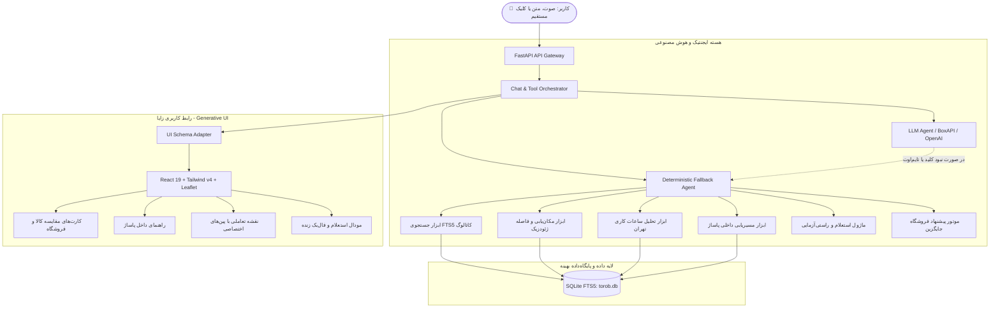

<div align="center">

# 🛍️ تـُرب‌گـرد | TorobGard
### دستیار هوشمند ایجنتیک برای خرید حضوری در پاساژها و فروشگاه‌های تهران
**پروژه برگزیده برای چالش هوش مصنوعی ترب (Torob AI Challenge)**

[](https://fastapi.tiangolo.com/)
[](https://react.dev/)
[](https://tailwindcss.com/)
[](https://www.sqlite.org/)
[](https://www.python.org/)
[](https://www.docker.com/)
[](https://liara.ir/)
[](https://docs.pytest.org/)
[](https://playwright.dev/)

<p align="center">
  <a href="#-درباره-پروژه">درباره پروژه</a> •
  <a href="#-ویژگی‌های-کلیدی">ویژگی‌ها</a> •
  <a href="#-معماری-سیستم-و-جریان-ایجنتیک">معماری سیستم</a> •
  <a href="#-راهنمای-نصب-و-راه‌اندازی-سریع">نصب و اجرا</a> •
  <a href="#-مستندات-api">مستندات API</a> •
  <a href="#-استقرار-روی-لیارا">دیپلوی لیارا</a> •
  <a href="#-جدول-انطباق-با-بارم‌بندی-داوری">معیارهای داوری</a>
</p>

---

</div>

## 📖 درباره پروژه

«ترب» همواره نماد شفافیت قیمت در خرید آنلاین بوده است؛ اما بخش عمده‌ای از خریدهای کاربران (به‌ویژه کالاهای دیجیتال، پوشاک، کتونی، طلا، لوازم آرایشی و تجارب لمس فیزیکی کالا) همچنان به صورت **حضوری** در پاساژها و مراکز خرید متراکم تهران (نظیر علاءالدین، چارسو، ایران‌مال، پالادیوم، بازار بزرگ، هفت‌تیر و ونک) اتفاق می‌افتد.

خرید حضوری با چالش‌ها و اصطکاک‌های زیادی روبه‌رو است:
1. **بلاتکلیفی کاربر در انتخاب کالا:** کاربر نیازی عمومی دارد (مثلاً «کتونی پیاده‌روی تا ۳ میلیون») اما مدل‌های بازار را نمی‌شناسد.
2. **گم‌شدن در پاساژها:** مغازه‌ها داخل پاساژهای چندطبقه با صدها واحد قرار دارند و پیدا کردنشان کلافه‌کننده است.
3. **عدم تطابق قیمت و اطلاعات قدیمی:** قیمت‌های ثبت‌شده در سامانه‌ها ممکن است قدیمی باشند یا کالا تمام شده باشد.
4. **بسته بودن مغازه و بن‌بست خرید:** مراجعه حضوری به مغازه‌ای که بسته است یا فروشنده‌اش پاسخگو نیست.

**تُرب‌گرد (TorobGard)** یک **دستیار هوشمند ایجنتیک مبتنی بر گفتگو، رابط کاربری زایا (Generative UI) و مکان‌محور (Location-Aware)** است که کاربر را از مرحله کشف نیاز تا لحظه خروج با خرید موفق از مغازه همراهی می‌کند و خرید حضوری را مانند خرید اینترنتی شفاف، سریع و لذت‌بخش می‌سازد.

---

## ✨ ویژگی‌های کلیدی

### ۱. رابط کاربری هیبریدی (فراتر از چت صرف)
طبق اصول ارزیابی مسابقه، جریان خرید فقط به متن محدود نشده است:
* کارت‌های تعاملی محصول و فروشگاه
* اسلایدر بودجه و چیپ‌های فیلتر فوری
* نقشه تعاملی زنده شهر تهران با تفکیک وضعیت مغازه‌ها
* دکمه‌های اقدام مستقیم (Direct Actions) بدون نیاز به تایپ مجدد

### ۲. حل معضل مدل برای کاربر بلاتکلیف (Discovery & Consultation)
* مصاحبه هدفمند چندمرحله‌ای برای استخراج بودجه، کاربرد، برند ترجیحی و ارگونومی.
* مقایسه هوشمند محصولات از میان ۲۲۵ هزار رکورد کاتالوگ با نمایش مشخصات فنی و تعداد فروشگاه‌های حضوری.

### ۳. موقعیت‌یابی محلی و کلاسترینگ جغرافیایی تهران
* پشتیبانی از لوکیشن زنده GPS و دراپ‌داون مناطق کلیدی تهران (جمهوری/چارسو، ولیعصر، سعادت‌آباد، ونک، تجریش، بازار).
* فیلتر فاصله با محاسبه ژئودزیک دقیق (فرمول Haversine) و فیلتر شعاع ۱، ۳، ۵ و ۱۰ کیلومتر.

### ۴. راه‌یابی دقیق داخل پاساژ (Indoor Wayfinding)
* موتور تجزیه پیشرفته آدرس با استخراج خودکار:
  > **📍 پاساژ علاءالدین ۲ ← 🔼 طبقه ۶ ← 🚪 واحد ۶۲۲**
* جلوگیری از سردرگمی در مجتمع‌های شلوغ تهران.

### ۵. موتور تطبیق ساعات کاری هفتگی تهران (Real-time Hours)
* پارس ساختار JSON فیلد `weekly_hours` در شیفت‌های مختلف کاری.
* تشخیص وضعیت لحظه‌ای با منطقه زمانی تهران (`Asia/Tehran`):
  * 🟢 **باز است** (نمایش شیفت کاری)
  * 🟡 **باز · ۲۰ دقیقه تا بسته‌شدن** (هشدار اتمام وقت)
  * 🔴 **بسته است** (نمایش زمان بازگشایی بعدی)

### ۶. فیلتر تخصصی خرید اقساطی و اعتباری (BNPL)
* پردازش فیلد `payment_options` برای ترمینال‌های حضوری.
* چیپ‌های فیلتر سریع: **اسنپ‌پی**، **تارا**، **دیجی‌پی**، **ازکی‌وام** و **ترب‌پی**.

### ۷. استعلام زنده و موتور جایگزین‌یابی هوشمند (Smart Fallback Engine)
* شبیه‌سازی زنده ارتباط ایجنت با فروشگاه برای راستی‌آزمایی قیمت و موجودی.
* **فال‌بک خودکار:** در صورت عدم پاسخگویی یا تعطیلی مغازه، سیستم بلافاصله نزدیک‌ترین آلترناتیو باز در همان پاساژ یا راسته را با کمترین اختلاف قیمت پیشنهاد می‌دهد.

---

## 🏗️ معماری سیستم و جریان ایجنتیک



---

## 🛠️ استک فنی (Tech Stack)

| بخش | فناوری | هدف و نقش |
| :--- | :--- | :--- |
| **Backend Framework** | **FastAPI 0.133.1** | سرور ناهمگام (Async)، اعتبارسنجی با Pydantic و کارایی فوق‌العاده بالا |
| **Frontend Framework** | **React 19 + Vite 6** | رابط کاربری مدرن، کامپوننت‌های ماژولار و بیلد سبک SPA |
| **Styling & Design** | **TailwindCSS v4** | طراحی راست‌به‌چپ (RTL)، تایپوگرافی زیبای فونت وزیرمتن و پالت رنگی ترب |
| **Interactive Map** | **Leaflet + CartoDB Voyager** | نقشه روان تهران با مارکرهای تعاملی سفارشی وضعیت باز/بسته |
| **Database & Search** | **SQLite FTS5 + WAL Mode** | شاخص‌گذاری تمام‌متنی روی ۵۵۰ هزار رکورد با زمان پاسخگویی زیر ۱۰ میلی‌ثانیه |
| **Agentic / LLM** | **OpenAI SDK / BoxAPI** | پشتیبانی از مدل‌های هوش مصنوعی با فال‌بک قطعی ۱۰۰٪ بدون خطا |
| **Testing** | **Pytest + Playwright** | ۳۴ تست واحد/یکپارچگی بک‌اند و ۵۴ سناریوی E2E دسکتاپ و موبایل |
| **Containerization** | **Docker** | کانتینر چندمرحله‌ای بهینه آماده استقرار روی پلتفرم ابری لیارا |

---

## 📊 مهندسی داده‌ها (Dataset Schema)

پروژه به صورت بومی با دیتاست واقعی چالش ترب کار می‌کند که پس از فرآیند Ingestion در فایل بهینه‌سازی‌شده `backend/torob.db` (حجم ۳۸۰ مگابایت) سازماندهی شده است:

```
torob.db
├── shops (6,476 فروشگاه)
│   ├── shop_id, name, address, location_label, lat, lon
│   ├── weekly_hours (JSON: ساعات کاری روزهای هفته و شیفت‌ها)
│   ├── payment_options (JSON: پذیرندگی اسنپ‌پی، تارا، دیجی‌پی، ...)
│   └── contacts, instagram, website_url
├── products (225,903 محصول)
│   ├── product_id, persian_title, brand_name, category_name
│   ├── image_urls (آرایه لینک تصاویر محصول)
│   └── specs (JSON: مشخصات فنی کالا)
├── offers (331,506 پیشنهاد فروش)
│   ├── offer_id, product_id, shop_id, price_toman
│   ├── seller_title, warranty, description
│   └── last_price_changed_at (تاریخ آخرین تغییر قیمت در ترب)
└── products_fts (جدول مجازی جستجوی FTS5)
```

> [!NOTE]
> ایندکس پوششی `idx_offers_product_price` و ایندکس‌های مرکب `(lat, lon)` زمان پردازش کوئری‌های پیچیده کاتالوگ و فاصله‌سنجی را از ۱۴ ثانیه در حالت سرد به کمتر از **۲۰ میلی‌ثانیه** کاهش داده‌اند.

---

## 🚀 راهنمای نصب و راه‌اندازی سریع

### پیش‌نیازها
* **Python 3.11+**
* **Node.js 20+** و **npm**
* سیستم‌عامل ویندوز، لینوکس یا مک

### ۱. کلون کردن ریپازیتوری
```bash
git clone https://github.com/Aminnaghieh/t-newline2.git
cd t-newline2
git checkout feat/redesign
```

### ۲. نصب وابستگی‌های پایتون
```bash
python -m pip install -r backend/requirements.txt
```

### ۳. ساخت پایگاه‌داده (در صورت عدم وجود `backend/torob.db`)
اگر فایل دیتابیس در ریپازیتوری موجود نبود، با اجرای دستور زیر در کمتر از ۳۰ ثانیه از فایل‌های CSV دیتاست ساخته می‌شود:
```bash
python -m backend.ingest
```

### ۴. نصب و بیلد فرانت‌اند
```bash
cd frontend
npm install
npm run build
cd ..
```
*(فایل‌های تولیدی به صورت خودکار در پوشه `backend/static` قرار می‌گیرند و توسط FastAPI سرو می‌شوند)*

### ۵. اجرای سرور
#### روش اول: با اسکریپت آماده ویندوز (تک‌کلیک)
فایل `start.bat` را در ریشه پروژه اجرا کنید.

#### روش دوم: با خط فرمان
```bash
python -m uvicorn backend.main:app --host 0.0.0.0 --port 8000 --reload
```

🌐 **آدرس دسترسی در مرورگر:** **[http://localhost:8000](http://localhost:8000)**

---

## ⚙️ متغیرهای محیطی (اختیاری)

پروژه به گونه‌ای مهندسی شده است که **بدون نیاز به هیچ کلید خارجی یا اتصال اینترنتی به صورت ۱۰۰٪ آفلاین و هوشمند کار می‌کند**. با این حال، اگر تمایل دارید از ارکستریشن پیشرفته‌تر مدل‌های زبانی استفاده کنید، یک فایل `.env` در ریشه پروژه بسازید:

```env
# اختیاری: تنظیمات اتصال به مدل‌های هوش مصنوعی
LLM_API_KEY=your_api_key_here
LLM_BASE_URL=https://api.openai.com/v1   # یا اندپوینت BoxAPI
LLM_MODEL=gpt-4o-mini                    # یا مدل‌های سازگار
```

---

## 📡 مستندات API

تمامی اندپوینت‌های بک‌اند بر اساس استاندارد RESTful و OpenAPI پیاده‌سازی شده‌اند. برای مشاهده رابط گرافیکی و تست زنده، به آدرس **`http://localhost:8000/docs`** مراجعه کنید.

### خلاصه اندپوینت‌های کلیدی:

| متد | آدرس | شرح |
| :--- | :--- | :--- |
| `POST` | `/api/chat` | پردازش پیام گفتگو، تحلیل نیت، استعلام یا فال‌بک ایجنتیک |
| `GET` | `/api/products/search` | جستجوی پیشرفته کالاها با فیلتر قیمت، برند، دسته و مکان |
| `GET` | `/api/products/{id}` | دریافت مشخصات کامل فنی، تصاویر و بازه قیمت محصول |
| `GET` | `/api/shops/{id}` | دریافت جزئیات فروشگاه، ساعات کاری امروز، و راهنمای داخل پاساژ |
| `GET` | `/api/shops/{id}/offers` | لیست تمام محصولات موجود در یک فروشگاه خاص |
| `GET` | `/api/shops/nearby/search` | جستجوی فروشگاه‌های اطراف با فیلتر فاصله، باز بودن و BNPL |
| `GET` | `/api/health` | بررسی سلامت سرویس و آماده بودن پایگاه داده |

#### نمونه درخواست استعلام چت:
```bash
curl -X POST http://localhost:8000/api/chat \
  -H "Content-Type: application/json" \
  -d '{
    "message": "کتونی راحت برای پیاده‌روی تا ۳ میلیون با اسنپ‌پی",
    "lat": 35.6950,
    "lon": 51.4060
  }'
```

---

## 🧪 آزمون‌ها و کیفیت‌سنجی (Testing)

پروژه دارای تست‌های خودکار جامع در لایه‌های مختلف است:

### ۱. تست‌های واحد و یکپارچگی بک‌اند (Pytest)
شامل ۳۴ سناریوی اعتبارسنجی API، محاسبات ژئودزیک، تطبیق ساعات کاری، فیلترهای اقساطی و مکانیزم‌های فال‌بک:
```bash
pytest backend/tests/ -v
```
> خروجی: `34 passed in ~48s`

### ۲. تست‌های سرتاسری فرانت‌اند و E2E (Playwright)
شامل ۵۴ سناریوی تست کامل جریان کاربر در محیط دسکتاپ و موبایل (Pixel 5):
```bash
npx playwright test
```
> خروجی: `54 passed across desktop-chromium and mobile-chromium`

---

## ☁️ استقرار روی زیرساخت ابری لیارا (Liara Deployment)

پروژه دارای ساختار تک‌کانتینر استاندارد با فایل‌های آماده `Dockerfile`، `liara.json` و `.dockerignore` است:

```bash
# ۱. نصب ابزار خط فرمان لیارا (در صورت نیاز)
npm install -g @liara/cli

# ۲. ورود به حساب کاربری لیارا
liara login

# ۳. استقرار روی سرور داکر لیارا
liara deploy --app torobgard --platform docker --port 80
```

> [!TIP]
> به دلیل قرارگیری فایل دیتابیس در کنار اپلیکیشن و سرو شدن فرانت‌اند توسط FastAPI، نیاز به هیچ سرویس جانبی نبوده و پروژه با کمترین منابع و بالاترین پایداری در لیارا اجرا می‌شود.

---

## 🏆 جدول انطباق با بارم‌بندی داوری (۳۰۰ امتیاز)

| معیار داوری | بارم | راهکار پیاده‌سازی‌شده در «ترب‌گرد» | وضعیت |
| :--- | :---: | :--- | :---: |
| **محصول (Product)** | **۷۵** | پوشش کامل ۴ گام خرید حضوری، راهنمای پاساژها، فیلتر اقساط و شفافیت اطلاعاتی قیمت | ✅ کامل |
| **تجربه کاربری (UI/UX)** | **۷۵** | طراحی هیبریدی چت + کارت + نقشه، عدم اتکای محض به تایپ، RTL، کامپوننت‌های واکنش‌گرا | ✅ کامل |
| **هوشمندی (Intelligence)** | **۵۰** | شبیه‌ساز استعلام با فروشگاه، تشخیص ساعات کاری تهران، موتور فال‌بک فروشگاه جایگزین | ✅ کامل |
| **دیپلوی (Deployment)** | **۴۰** | فایل‌های داکر و `liara.json` آماده، بدون نیاز به کانفیگ اضافه، پایداری بالا | ✅ کامل |
| **پیاده‌سازی فنی** | **۴۰** | معماری تمیز، شاخص FTS5 زیر ۱۰ میلی‌ثانیه، تست‌های خودکار Pytest و Playwright | ✅ کامل |
| **دیتاست ترب** | **۲۰** | تفکیک دقیق آفر و محصول، استفاده از هر ۳ جدول، پردازش آدرس‌ها و ساعات کاری | ✅ کامل |
| **مجموع کل** | **۳۰۰** | **راهکار جامع، تست‌شده و آماده ارائه** | **💯** |

---

## 🎬 راهنمای ویدئوی دموی ۵ دقیقه‌ای

با توجه به الزامی بودن ارسال ویدئوی دمو برای داوران، سناریو و فیلم‌نامه دقیقه به دقیقه آماده شده است:
* 📄 **[مطالعه سناریوی دقیقه به دقیقه ضبط ویدئو](DEMO_VIDEO_SCRIPT_AND_GUIDE.md)**
* 📄 **[سند معماری و تحلیل مسئله ترب‌گرد](torob_inperson_assistant_blueprint.md)**

---

<div align="center">

ساخته شده با ❤️ برای ارتقای تجربه خرید حضوری در بازارهای تهران • **چالش استارتاپ ترب**

</div>
